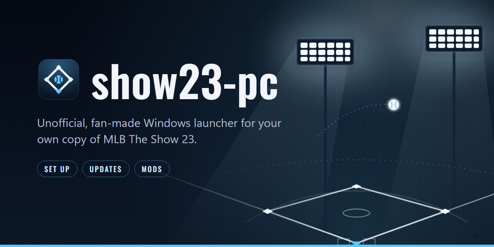

# show23-pc launcher



A Windows launcher for playing your own copy of MLB The Show 23 (PS4, `CUSA35521`) on PC. It sets the game up from your own game files, starts the companion emulator build and a small local server that stands in for the retired Diamond Dynasty online service, and can import the special cards from the publisher's public website on request. The launcher never downloads or distributes game files.

**Status: 0.1.1.** Setup, Play, Diamond Dynasty against the local server and the optional special-card import all work. Read [Known limits](#known-limits) before you start.

## For players

### What you need

- Windows 10 or 11, 64-bit.
- A graphics card with Vulkan support and current drivers.
- Your own, legally obtained copy of MLB The Show 23 for PS4 (`CUSA35521`), version 1.00, either as an unpacked folder or as a package file. The 1.21 update is optional; if you have it, most special-card pictures come from it.
- If you set up from a package file: an unpacker program of your own (`orbis-unpkg.exe` or `ps4-pkg-tool.exe`) and about 60 GB of free disk space for the unpacked copy. An unpacked folder is used where it is and is not copied.

### Download and set up

1. Download `show23-pc-0.1.0-win64-portable.zip` from the [Releases page](https://github.com/ChronoRixun/show23-pc-launcher/releases) and extract the whole zip to a folder of your choice. Keep `show23-pc.exe` and the `show23-pc` folder next to each other.
2. Run `show23-pc.exe` and choose **Set up**.
3. Choose your base game: an unpacked 1.00 folder, or a package file together with your unpacker. You can add the 1.21 update the same way (folder with folder, package with package). The first time you use an unpacker, the launcher shows its full path and asks before running it.
4. Pick a separate install folder. The launcher checks the game files, records where they are and copies the bundled emulator and server into the install. It never writes inside an unpacked game folder.

**Verify Files** checks the game folders and the installed runtime again at any time.

### Play

Press **Play**. The first time, the launcher asks for a player name (3 to 16 letters, digits, spaces, hyphens or underscores); you can change it later in Settings, where there are also **Fullscreen** and **Resolution** controls. Play starts the local server on your PC, then the game. When you close the game, the server stops too; **Stop** ends both.

**Resolution** defaults to **1080p (1920×1080)**. Choose **720p (1280×720)** in Settings if you prefer. The launcher applies the choice on the next Play to both the internal render size and initial window size. If it cannot read or update `config.json`, it stops before launching and leaves the existing file in place.

Play always starts version 1.00 of the game, also when the 1.21 update is set up. The update is used for card pictures; this release has no way to play 1.21 itself.

In Diamond Dynasty you start with your chosen name, a 26-player squad of Common cards from the game's own roster and 5,000 Stubs. Packs, exchanges, Programs (including Team Affinity), Showdown, Mini Seasons and Conquest all work against the local server. The Community Market and buying Stubs are switched off, and there is no play against other people.

### Import special cards (optional)

Without an import you have the Live roster cards from your game files, with player photos where the game has them. **Import special cards** on the Home page (also offered after setup) adds the special cards:

- Your own PC downloads the card list, and only the pictures your game files lack, from the publisher's public website (`mlb23.theshow.com`). That is about 35 MB and takes about 5 minutes.
- It adds about 1,775 special cards with their designed art, mostly taken from your own 1.21 update files, and 40 event packs (Chase Packs, Diamond Duos and the Lou Gehrig Day pack).
- About 211 special cards are left out because they could not be matched to a player in the game's roster.
- Stop the game first, and turn off Offline mode. You can cancel; finished pages are kept and the next run continues. **Update special cards** runs it again later.

The import is optional and runs only when you press the button. It uses a website run by the publisher, so please be aware of that site's terms before you use it. Nothing is sent to this project.

### Manual mode (no launcher)

The portable release includes `manual/README.txt`. From the extracted folder, run `manual\setup.cmd <install> <base> [update]`, then `manual\play.cmd <install> [--fullscreen]`. On Linux, the shell wrappers use Python 3.10 or later and a separate Linux shadPS4 build from the emulator repository's `release` branch. Use unpacked game folders. The Windows launcher can adopt a manual Windows install later.

### Where your files are

Inside your install folder:

| What | Where |
|---|---|
| Game saves and emulator settings | `data\profiles\default\user\` |
| Diamond Dynasty progress (cards, Stubs, modes), this install's certificates | `data\profiles\default\server\` |
| Imported special cards | `data\import-cache\` |
| Server, emulator and card-import logs | `data\logs\` |

Back up the whole `data\profiles` folder to keep your progress. The launcher's own settings and logs are in the `show23-pc\data\` folder next to `show23-pc.exe`; **Support → Open logs folder** opens its logs.

### Known limits

- Frame rate: menus run smoothly, but games have small stutters and do not hold a steady 60 frames a second.
- A full CPU game has not yet been played from start to finish in the release build.
- The Captain card feature is unverified.
- About 211 special cards are left out of the import because they could not be matched to a roster player.
- Choice packs are not supported.
- To move from version 0.1.2 or earlier, extract a new full ZIP and choose your existing game install. Close the launcher and wait for it to exit before extracting over an existing portable folder. For versioned releases, the launcher can download a new version and test its startup before making it current.
- Play uses game version 1.00. The launcher and its bundled emulator target Windows.
- You need your own legally obtained copy of the game. Nothing here contains game files or card art.

### Reporting problems

Open an issue on [GitHub](https://github.com/ChronoRixun/show23-pc-launcher/issues). Say what you did and what happened, paste the text from **Support → Copy diagnostics** (read it first) and attach the newest logs from `data\logs\` in your install. Please never post game files, keys, accounts or links to them.

## For builders

### Build from source

Use Windows x64, Visual Studio 2022 or its Build Tools with the Desktop development with C++ workload, Windows SDK and C++ ATL, Premake 5 with Visual Studio 2022 support, and PowerShell. Put `premake5.exe` on PATH or set `SHOW23_PREMAKE` to its full path. The generator obtains pinned dependency sources and the Chromium Embedded Framework (CEF) runtime, approximately 260 MB. A plain source archive without git history also builds.

~~~bat
generate.bat
msbuild build\show23-pc.sln /m /p:Configuration=Release /p:Platform=x64
build\bin\x64\Release\show23-pc-tests.exe
node src\tests\ui\run.js
~~~

The build produces the real launcher at `build\bin\x64\Release\show23-pc.exe` and the bootstrap at `build\bin\x64\Release\show23-pc-bootstrap.exe`. For developer runs from the build directory, stage the browser first with `tools\stage-runtime.ps1`. The installed data root remains `%LOCALAPPDATA%\show23-pc`. In a release ZIP, browser files are kept with their version and the Settings data location control moves user settings only.

For source setup, `generate.bat` fetches the five repositories listed in `.gitmodules` from GitHub when initialized as submodules. In a plain source directory it fetches the pinned source archives from `https://codeload.github.com/<owner>/<repo>/zip/<commit>`. CEF is fetched from `https://cef-builds.spotifycdn.com/<cef-build>.tar.bz2`. These are developer build-time contacts.

### Package the playable release

Build Release x64 with the exact tag in SHOW23_PACKAGE_VERSION, then pass the frozen 0.1.2 portable ZIP and its release manifest to the packager. For example, to package the first versioned Beta:

```powershell
$env:SHOW23_PACKAGE_VERSION = '0.1.3-beta.1'
# Build Release x64 with that environment before running the packager.
.\tools\package-release.ps1 -Version 0.1.3-beta.1 -MinLauncher 0.1.3-beta.1 -FrozenRuntimeZip $frozenZip -FrozenRuntimeManifest $frozenManifest
```

Both packager entry points produce one portable ZIP, its release manifest and SHA256SUMS.txt. Use the same -MinLauncher value for subsequent versioned releases, including Stable, if a Beta was published first. The packager checks the 0.1.2 ZIP against its release manifest and verifies every bundled runtime file. The ZIP contains the bootstrap, one complete version folder, stable manual forwarders, the player README and licences. Publish the three assets together.

`-PillowWheel` takes a local Pillow wheel that matches the embedded Python's ABI for Windows x64 (0.1.0 uses Python 3.14.7 and Pillow 13.0.0, `cp314`). It enables conversion of imported PNG and JPEG card art to WebP; without it those few pictures fall back to the plain player photo.

### Update channels

Stable is the default and selects final releases. Beta includes pre-releases. Settings → Updates shows the installed version for the launcher, emulator, server and profile. A pre-release is marked Beta. The launcher asks before switching a portable Beta back to an older Stable release. Keep the beta leaves it installed. Tagged Release builds in installed mode can open the release page for a manual update. Parts without a separate release are marked **Included with the launcher** when bundled. The Installed column shows the version active in the game install. The game runtime is frozen at the bundle supplied in 0.1.2. Setup or Play can install it to a fresh game install. If your active runtime fails verification and the bundle supplies the same versions, Home offers **Repair runtime** while Play is stopped. Repair keeps your game data, saves and settings in place. On a versioned install, the bootstrap runs the selected launcher version from its own folder and keeps user settings in the shared data folder. Release assets and compatibility rules are documented in [Release manifests](docs/release-manifest.md).

## Privacy

The launcher does not send game paths, game files, saves, content packs or diagnostics. Diagnostics are displayed locally and can be copied to the clipboard.

| Address | When |
| --- | --- |
| `https://api.github.com/repos/ChronoRixun/show23-pc-launcher/releases/latest` on Stable, or `https://api.github.com/repos/ChronoRixun/show23-pc-launcher/releases?per_page=30` on Beta | Startup for tagged release builds, a channel change, or a player-requested update check |
| `https://api.github.com/repos/ChronoRixun/show23-pc-emulator/releases/latest` on Stable, or `https://api.github.com/repos/ChronoRixun/show23-pc-emulator/releases?per_page=30` on Beta | When the player chooses Check for updates |
| `https://api.github.com/repos/ChronoRixun/show23-pc/releases?per_page=30` | When the player chooses Check for updates. The server and profile share the listing |
| `https://github.com/ChronoRixun/show23-pc-launcher/releases/download/<tag>/<asset>` | After the player approves an update. Assets are `launcher.json`, `SHA256SUMS.txt` and `show23-pc-<version>-win64-portable.zip` |
| `https://release-assets.githubusercontent.com/…` and `https://objects.githubusercontent.com/…` | When GitHub redirects a release asset download |
| `https://github.com/ChronoRixun/show23-pc-launcher/releases/tag/v<version>` | Opens the offered version's release page in the default browser when requested from the updater |
| `https://mlb23.theshow.com/apis/items.json?type=mlb_card&page=<n>` and the picture addresses that list names | Only when the player chooses Import special cards. The bundled server makes these requests, at least 750 ms apart, with a generic user agent and nothing about the player |

The embedded interface uses `http://show23-pc.invalid/` internally. CEF serves that origin from local files and native commands. The default browser and Windows handle their own networking, including certificate validation. Play starts the local server on 127.0.0.1 and the game talks only to it. Use `-offline` at startup or enable **Offline mode** in Settings and restart to disable the launcher's release contacts and the card import.

## Legal

This is an unofficial fan project. It is not affiliated with or endorsed by Sony Interactive Entertainment, San Diego Studio, Major League Baseball or the MLB Players Association. *MLB The Show* and related names are trademarks of their owners and are used only to identify what the software works with. You need your own legally obtained copy of the game; this project redistributes no game files and no card art.

## Credits

- [shadPS4](https://github.com/shadps4-emu/shadPS4) and its contributors: the PS4 emulator the game runs on, including its renderer and shader recompiler. The [show23-pc-emulator](https://github.com/ChronoRixun/show23-pc-emulator) build in the release is a fork of it under GPL-2.0-or-later.
- [mlb_pc](https://github.com/victorgbd/mlb_pc), the PC port of MLB The Show 24: an inspiration and a reference. The fix notes in its `MLB_PORT.md` on this engine's crowd, nets, faces and GPU counters informed several of our engine fixes.
- This launcher is adapted from [Ultimate Legends](https://github.com/ChronoRixun/ultimate-legends) by the same author. Ultimate Legends is a fork of the [CB Servers Launcher](https://github.com/CBServers/cb-launcher) by CB Servers (© 2026 CB Servers). Its foundation is the [XLabs Launcher](https://github.com/XLabsProject/launcher), originally developed by [momo5502](https://github.com/momo5502) and the XLabs team. The lead author also added the scope guard’s cancellation method.
- [showdd.io](https://www.showdd.io/), a community card database, was a reference during research for which cards past Chase Packs and Diamond Duos featured. The software does not use it.

### Bundled software

The release zip contains the following; each licence text is in its `LICENSES` folder.

| Component | Licence | File in `LICENSES` |
| --- | --- | --- |
| This launcher | GPL-3.0 | `launcher-GPL-3.0.txt` |
| show23-pc server | MIT | `server.txt` |
| show23-pc-emulator (shadPS4 fork), source link and commit | GPL-2.0-or-later | `emulator/LICENSE.txt`, `emulator/SOURCE.txt` |
| [Chromium Embedded Framework](https://bitbucket.org/chromiumembedded/cef) 113 with Chromium | BSD-3-Clause; Chromium's components under their own licences | `browser.txt` |
| [libcurl](https://curl.se/) | curl licence | `curl.txt` |
| [RapidJSON](https://github.com/Tencent/rapidjson) | MIT | `rapidjson.txt` |
| [miniz](https://github.com/richgel999/miniz) | MIT | `miniz.txt` |
| [LibTomCrypt](https://github.com/libtom/libtomcrypt) and [LibTomMath](https://github.com/libtom/libtommath) | The LibTom license (public domain) | `libtomcrypt.txt`, `libtommath.txt` |
| [Python](https://www.python.org/) 3.14.7 embeddable | PSF License 2.0, with the notices for its Windows build | `python.txt` |
| [Pillow](https://python-pillow.org/) 13.0.0 | MIT-CMU, with the notices for the image libraries it bundles | `pillow.txt` |
| [Oswald](https://github.com/googlefonts/OswaldFont) font | SIL Open Font License 1.1 | `OFL.txt` |

## Licence

The launcher is licensed under the [GNU General Public License v3.0](LICENSE). The interface bundles Oswald under the [SIL Open Font License 1.1](src/launcher-ui/assets/fonts/OFL.txt). The emulator and the server are separate programs under their own licences.
